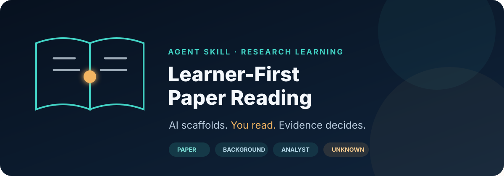
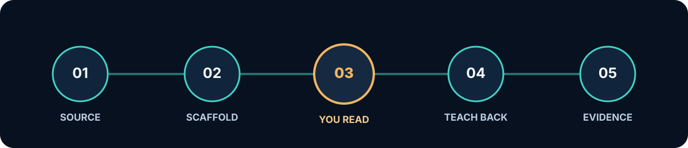

<p align="center">
  
</p>

<p align="center">
  <a href="README.zh-CN.md">简体中文</a> ·
  <a href="#quick-start">Quick start</a> ·
  <a href="tests/evaluation-results.md">Evaluation</a> ·
  <a href="ACKNOWLEDGMENTS.md">Acknowledgments</a>
</p>

<p align="center">
  <a href="https://github.com/HPPPK/learner-first-paper-reading/actions/workflows/validate.yml"></a>
  <a href="https://github.com/HPPPK/learner-first-paper-reading/releases"></a>
  <a href="LICENSE"></a>
  <a href="SKILL.md"></a>
</p>

# Learner-First Paper Reading

**AI scaffolds. You read. Evidence decides.**

An Agent Skill for people who want to understand a research paper rather than
receive another polished summary. It teaches only the prerequisites needed for
the next passage, sends the learner back to the original source, checks their
explanation, and keeps claims inside the evidence actually inspected.

The intended finish line is simple: you can explain the paper's problem, method,
evidence, and valid scope in your own words.

## Why learner-first?

A summary-first assistant can make an unfamiliar paper feel clear while leaving
the reader unable to reconstruct it. This workflow changes who does the central
intellectual work.

| Summary-first interaction | Learner-first interaction |
| --- | --- |
| AI gives the complete interpretation | AI proposes a route and teaches the minimum prerequisite |
| The paper becomes optional | The learner reads a short, located passage or visual |
| Confidence substitutes for evidence | **Paper**, **Background**, **Analyst**, and **Unknown** stay separate |
| Criticism arrives before understanding | Reviewer-style criticism waits for a comprehension gate |
| “The code ran” becomes “reproduced” | Reproduction is recorded across six evidence states |

## A 30-second example

> **Learner:** I am new to time-series forecasting. Help me read the DLinear
> paper step by step.
>
> **Assistant:** Our goal is for you to explain the research question, method,
> and evidence independently. I will first verify the source, teach only the
> background needed for one short passage, and then pause for your reading and
> interpretation. You will read the original material and explain it back. Does
> that route fit your goal?

The pause is intentional. The assistant has not replaced the paper or the
learner's interpretation.

## How it works

<p align="center">
  
</p>

1. **Set the route.** State the learner's goal, assumed level, source coverage,
   roles, pauses, and completion target before substantive guided analysis.
2. **Bridge one prerequisite.** Explain the problem, mechanism, a small example,
   the precise definition, the paper role, and the boundary.
3. **Return to the paper.** Assign one located passage, figure, table, or equation
   and one consequential question.
4. **Use teach-back.** Accurate explanations move forward; demonstrated gaps get
   targeted reteaching and another look at the source.
5. **Audit evidence.** Connect claims to inspected evidence and limits. Finish
   with a closed-book explanation and explicit unknowns.

### Four voices

| Voice | Meaning |
| --- | --- |
| **Paper** | What the inspected focal source states or shows, with a location. |
| **Background** | External knowledge used for teaching, linked when useful. |
| **Analyst** | The assistant's interpretation, synthesis, or recommendation. |
| **Unknown** | Evidence that is missing, inaccessible, or not yet inspected. |

## Modes

- **Guided learning** — the default when someone asks to learn a paper.
- **Quick orientation** — source identity, prerequisite map, selective route, and
  first reading question.
- **Focused explanation** — explain one passage, formula, figure, or concept now,
  without forcing a guided session.
- **Deep evidence review** — claim, comparison, uncertainty, and limitation review
  after the method and evidence have been reconstructed.
- **Implementation/reproduction** — paper-to-code mapping and six distinct
  evidence states, from conceptual understanding to full reported coverage.

## Quick start

This repository root is the complete skill. Keep `SKILL.md`, `references/`,
`assets/`, and `agents/` together.

### Install with Codex

Ask the skill installer:

```text
Install the Agent Skill from https://github.com/HPPPK/learner-first-paper-reading
```

Or clone it into the personal skill directory documented by your Codex host:

```bash
git clone https://github.com/HPPPK/learner-first-paper-reading.git \
  ~/.agents/skills/learner-first-paper-reading
```

Some Codex installations use `~/.codex/skills/` instead of
`~/.agents/skills/`. Use the location documented by your client and install the
skill once to avoid duplicate names.

### Install with Claude Code

```bash
git clone https://github.com/HPPPK/learner-first-paper-reading.git \
  ~/.claude/skills/learner-first-paper-reading
```

Other Agent Skills hosts may use different locations and invocation syntax.
Compatibility is not a claim that every host has been tested.

### Start a paper

```text
Use $learner-first-paper-reading to help me learn the attached paper.
I am new to this field. Propose a route, teach the prerequisites for one short
reading assignment, and pause for my own interpretation.
```

In Claude Code, use `/learner-first-paper-reading` with the same request. For a
direct answer, explicitly ask for a focused explanation and provide the passage,
equation, or figure.

## See it in action

The [curated examples](examples/README.md) show three distinct routes:

- a guided DLinear opening that pauses for route agreement and original reading;
- a direct, worked explanation of `y = Wx + b`; and
- an evidence ledger that classifies a reported forward pass as state 3 only.

They are inspectable demonstrations, not proof of universal behavior or measured
learning outcomes.

## What is tested

- **37 core deterministic contract tests** check routing, explanation layers,
  source boundaries, evidence voices, figures, equations, reproduction states,
  attribution, and the skill package.
- **14 standalone project checks** cover bilingual parity, public links, examples,
  governance files, accessible SVGs, CI, and badges.
- **Seven sampled behavior scenarios** cover guided DLinear reading, direct
  equation explanation, prerequisite sourcing, misconception correction,
  premature criticism, a forward smoke test, and abstract-only access.
- The abstract-only scenario initially missed a future full-text reading plan;
  the narrow correction and a neighboring critique-deferral case were rerun.

These checks do not establish universal agent behavior, automatic discovery
across clients, or improved learning outcomes. No completed controlled learning
study is claimed. See the [scenario rubric](tests/scenarios.md),
[baseline controls](tests/baseline-observations.md), and
[with-skill evaluation](tests/evaluation-results.md).

Run the deterministic suites from the repository root:

```bash
python3 tests/validate_contract.py
python3 tests/validate_standalone.py
```

## Optional Norman integration

[Norman Paper Reading](https://github.com/N-tongxue/norman-skill/tree/main/norman-paper-reading)
can optionally provide its documented PDF extraction, original-figure rendering,
and source-mapping workflow. This skill works without Norman and does not bundle
its instructions, tools, binaries, branding, or templates. See
[ACKNOWLEDGMENTS.md](ACKNOWLEDGMENTS.md) for provenance and license boundaries.

## Limits

This repository contains instructions, not a model or enforcement mechanism.
Source access, visual inspection, citations, and code execution depend on the
host and its permissions. Abstract-only material supports an abstract-only plan.
A successful forward pass or one matching metric does not establish full
reproduction.

## License

The original files in this standalone repository are available under the
[MIT License](LICENSE). Acknowledged upstream projects retain their own rights;
this repository does not relicense upstream projects or imply endorsement by them.
