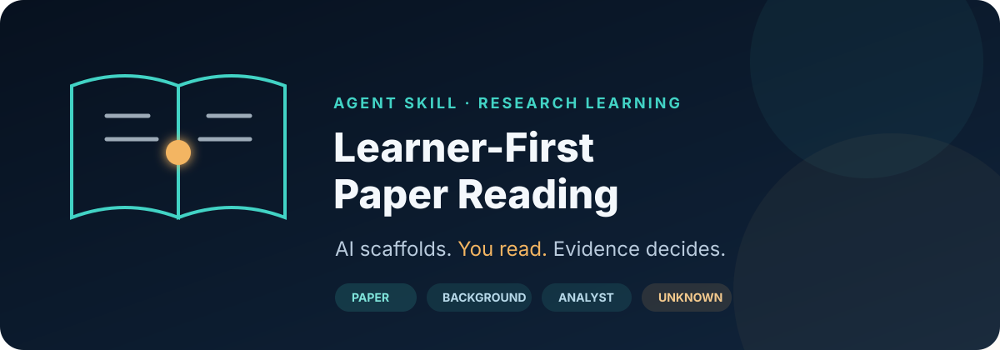
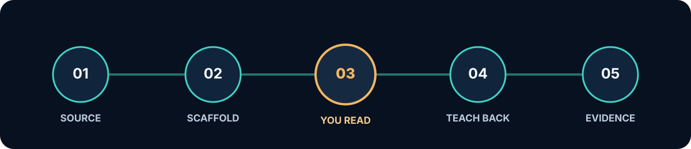

<p align="center">
  
</p>

<p align="center">
  <a href="README.md">English</a> ·
  <a href="#快速开始">快速开始</a> ·
  <a href="tests/evaluation-results.md">评估记录</a> ·
  <a href="ACKNOWLEDGMENTS.md">致谢</a>
</p>

<p align="center">
  <a href="https://github.com/HPPPK/learner-first-paper-reading/actions/workflows/validate.yml"></a>
  <a href="https://github.com/HPPPK/learner-first-paper-reading/releases"></a>
  <a href="LICENSE"></a>
  <a href="SKILL.md"></a>
</p>

# Learner-First Paper Reading

**AI scaffolds. You read. Evidence decides.**

这是一个帮助学习者真正读懂科研论文的 Agent Skill，而不是又一个自动摘要器。
AI 负责补上当前阅读所需的最小背景、定位原文、检查解释和守住证据边界；学习者
负责读原文、提出疑问，并用自己的话讲清楚论文。

最终目标不是“看过一份总结”，而是你能够独立解释论文的问题、方法、证据和
适用范围。

## 为什么强调 learner-first？

一份流畅的 AI 总结很容易制造“我好像懂了”的感觉，但读者可能仍然无法复述
方法或判断证据。这个工作流重新分配了任务：AI 提供脚手架，关键理解由学习者
完成。

| 摘要优先 | 学习者优先 |
| --- | --- |
| AI 直接给出完整解释 | AI 先说明路线，只补下一步必需的背景 |
| 原论文变成可选材料 | 学习者必须阅读一段可定位的原文或图表 |
| 语气自信代替证据 | **Paper、Background、Analyst、Unknown** 明确分开 |
| 还没看懂就开始挑缺点 | 通过理解门槛后再进入审稿式批评 |
| “代码跑通”等于“复现成功” | 用六种证据状态记录复现进度 |

## 30 秒看懂它怎么工作

> **学习者：**我是时间序列新手，请一步步带我读 DLinear 论文。
>
> **AI：**我们的目标是让你最后能独立讲清研究问题、方法和证据。我会先核对
> 来源，只补一小段阅读所需的背景，然后停下来让你读原文并解释；你负责阅读
> 和复述，我负责定位材料、解释卡点和检查推理。这个路线符合你的目标吗？

这里的暂停是刻意设计的：AI 没有替学习者完成最关键的理解过程。

## 工作流程

<p align="center">
  
</p>

1. **先说明路线。** 在引导式精读开始前，说明目标、基础水平、可用来源、双方
   角色、暂停点和完成标准。
2. **只补一个必要背景。** 按“问题—机制—小例子—精确定义—论文中的作用—
   边界”解释，不用整门课程淹没当前阅读。
3. **回到论文。** 指定一段可定位的原文、图、表或公式，并只留一个关键问题。
4. **让学习者复述。** 理解正确就继续；暴露出具体误解才进行针对性补课，然后
   再回原文核对。
5. **检查证据。** 把主张、证据和边界对应起来，最后闭卷复述并记录尚未解决的
   Unknown。

### 四种声音

| 标签 | 含义 |
| --- | --- |
| **Paper** | 已检查的目标论文明确说了什么、展示了什么，并给出位置。 |
| **Background** | 用来教学的外部知识，必要时附权威链接。 |
| **Analyst** | AI 的解释、综合判断或下一步建议。 |
| **Unknown** | 尚未获得、无法访问或还没有检查的证据。 |

## 使用模式

- **引导式学习**：用户想真正学会一篇论文时的默认模式。
- **快速导读**：核对来源、列出最小背景地图、安排第一段阅读。
- **聚焦解释**：现在就解释一个概念、段落、公式或图，不强迫用户进入问答流程。
- **深度证据审查**：理解方法和实验后，再检查主张、比较公平性和局限。
- **实现与复现**：从 paper-to-code 对照到完整结果覆盖，分别记录六种证据状态。

## 快速开始

本仓库根目录就是完整 Skill。请保留 `SKILL.md`、`references/`、`assets/`
和 `agents/`，不要只复制一个入口文件。

### 在 Codex 中安装

可以直接让 Skill Installer 安装：

```text
请安装这个仓库中的 Agent Skill：
https://github.com/HPPPK/learner-first-paper-reading
```

也可以克隆到 Codex 客户端文档指定的个人 Skill 目录：

```bash
git clone https://github.com/HPPPK/learner-first-paper-reading.git \
  ~/.agents/skills/learner-first-paper-reading
```

部分 Codex 安装使用 `~/.codex/skills/`。请以当前客户端文档为准，并且只安装
一次，避免出现同名 Skill。

### 在 Claude Code 中安装

```bash
git clone https://github.com/HPPPK/learner-first-paper-reading.git \
  ~/.claude/skills/learner-first-paper-reading
```

其他 Agent Skills 宿主可能使用不同目录和调用方式；这里不声称所有客户端都已
完成兼容性测试。

### 开始读论文

```text
Use $learner-first-paper-reading to help me learn the attached paper.
我是这个方向的新手。请先提出阅读路线，只讲第一段阅读所需的背景，
然后停下来让我自己读和解释。
```

在 Claude Code 中可以用 `/learner-first-paper-reading`。如果只想立即解释一个
公式或段落，请明确说“直接解释”，不需要进入多轮引导流程。

## 查看实际示例

[三个精选示例](examples/README.md)分别展示：

- DLinear 引导式开场，先确认路线，再把阅读任务交还给学习者；
- 对 `y = Wx + b` 的直接机制讲解和手算例子；
- 把一次用户报告的 forward pass 严格记录为 state 3，而不是“复现成功”。

这些是可检查的演示，不是所有 Agent 都会稳定遵守流程或学习效果已提升的证据。

## 测试与证据

- **37 项核心 deterministic contract tests** 检查模式路由、解释层次、来源
  边界、四种声音、图表、公式、复现状态、致谢和 Skill 打包结构。
- **14 项 standalone project checks** 检查中英文一致性、公开链接、示例、治理
  文件、SVG 可访问性、CI 和 badges。
- **seven（七）个抽样行为场景**覆盖 DLinear 引导阅读、公式直讲、外部背景来源、
  误解纠正、过早批评、forward smoke test 和只有摘要的情况。
- 只有摘要的场景最初遗漏了未来全文阅读计划；修正规则后重新测试，同时复测了
  相邻的“拒绝凭空挑缺点”场景。

这些检查不能证明模型在所有情况下都会遵守流程，也没有建立跨客户端的
**automatic discovery**，更没有证明真实的 **learning outcomes**。项目不声称
已经完成受控学习实验。详情见[场景标准](tests/scenarios.md)、
[无 Skill 基线](tests/baseline-observations.md)和
[使用 Skill 的评估](tests/evaluation-results.md)。

在仓库根目录运行：

```bash
python3 tests/validate_contract.py
python3 tests/validate_standalone.py
```

## 可选 Norman 集成

[Norman Paper Reading](https://github.com/N-tongxue/norman-skill/tree/main/norman-paper-reading)
可以作为可选的 PDF 提取、论文原图渲染和来源定位工具。本 Skill 不依赖 Norman，
也没有打包它的指令、工具、二进制文件、品牌或模板。来源和权利边界见
[ACKNOWLEDGMENTS.md](ACKNOWLEDGMENTS.md)。

## 边界

这个仓库提供的是指令工作流，不是模型或强制执行器。来源访问、图像检查、引用
和代码运行取决于宿主及其权限。只有摘要时，只能给出摘要范围内的学习计划。
一次 forward pass 或一个匹配指标都不能证明完整复现。

## 许可证

本独立仓库中的原创文件采用 [MIT License](LICENSE)。致谢中的上游项目继续保留
各自的权利；本仓库不会替它们重新授权，也不代表获得上游作者背书。
